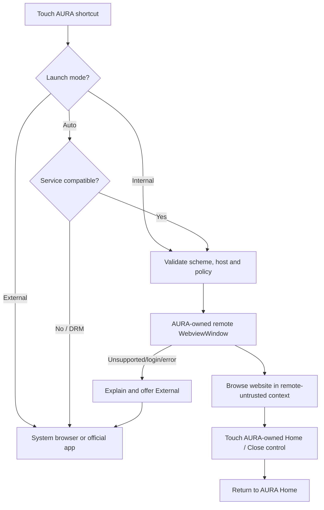
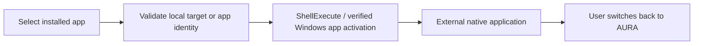

# AURA Architecture & UX Contract

## One-sentence contract

AURA is a **Windows-native host application** for a touch-optimized media experience. It owns the Home UX and local settings; untrusted remote websites must not share the host's native capabilities.

## User journeys

### Internal-compatible website

### Native application

An ordinary third-party Windows `.exe` cannot be hosted seamlessly as an HTML child of AURA. Do not suggest otherwise.

## Architectural decision: native window, not iframe

- Stable Tauri 2 `WebviewWindow`: single webview in a separate window, same AURA process/application. Best first implementation.
- Unstable Tauri 2 child Webview: may allow an embedded pane inside a shared native window, but currently needs the Rust `unstable` feature; isolate behind a proof-of-concept and flag only if stable-window UX is inadequate.
- HTML iframe: inadequate as universal web browsing due CSP / X-Frame-Options and DRM.
- External Edge: reliable fallback, but **not internal**.

### The critical toolbar problem

A third-party remote page fills its own webview, and the main window cannot simply render its own HTML _inside_ that remote surface. Investigate a trusted native overlay or separate dedicated control window (z-order, focus, pointer, DPI and fullscreen) for Home / Close; this must be usable by touch on Surface. If a stable solution cannot be verified, record the limitation and perform a gated child-webview proof of concept. Don't label Phase 1 complete until the route home is tested physically.

## Security zones

| Zone                               | Trust                        | Available native capability          |
| ---------------------------------- | ---------------------------- | ------------------------------------ |
| Main AURA UI, bundled `index.html` | Trusted app UI               | Narrow native commands only          |
| Remote service `https://…`         | Untrusted                    | **None**                             |
| External browser / player          | Separate process             | No AURA internal commands            |
| Rust backend                       | Trusted enforcement boundary | Validate every URL/target and caller |

Rules: CSP for local AURA UI must be restrictive; no wildcard capabilities to remote origins or remote webview labels. Validate schemes, origins, app path inputs at Rust boundary. Restrict navigation from privileged local views to untrusted origins. Remote content should never load through trusted asset origin, have preload scripts with privileged access, or trigger a command bridge. Prevent cross-window data leakage. Use secure OS credential store for API credentials; do not copy Edge or browser cookies.

## Launch mode policy

- **Internal**: website in AURA-owned webview window if supported; report precise errors with fallback.
- **External**: default browser, official application or configured external media player.
- **Auto**: per-provider compatibility policy; validated internal first, known DRM-restricted services external first.
- User override must not bypass security restrictions. When an unsupported mode is chosen, inform user rather than silently ignoring it.

## Storage and migrations

Existing key `aura-shortcuts-v1` stores manually configured shortcut records. Introduce versioned settings and migration with backups (and rollback logic if needed). Preserve `favorite`, `color`, `title`, `target`, and `mark` during migration. No credentials in `localStorage`; any account login handled through verified webview profiles or OS credential storage with documented limitations.

## UI standards

Dark matte surfaces, restrained sand/blue/green accent options, readable 3:2 Surface layout, minimum 44px touch targets, focus/hover/touch parity, reduced-motion mode, view transitions that are not jarring. Home remains fast offline. User always retains an explicit Exit to Windows.

## Service compatibility

Streaming compatibility requires real hardware tests of login, playback, audio, fullscreen, and popups. Embedded page load does **not** demonstrate playback compatibility. Widevine/PlayReady/other DRM behavior is dependent on runtime/provider and cannot be bypassed. Default DRM-heavy commercial providers to External until verified.

## Implemented Phase 0/1 boundaries (2026-10-20)

- main: local index.html, narrow shortcut launch commands and window controls; only local Home-navigation event subscription.
- service: external HTTP(S) document, no application/core capability, remote navigation checks and no popups/downloads.
- browser-controls: local browser.html, owned by service; only status, Home, Retry and original-target external fallback.
- BrowserState: one native session, approved original target, HTTP consent, generation ID and non-sensitive origin/status. No credentials in bridge messages or settings.
- Shortcut persistence: version 2 envelope in aura-shortcuts-v2; original aura-shortcuts-v1 and backup retained during migration. Corrupt/future data is not overwritten.
- Native entrypoint recreates main from config with a trusted-route navigation guard; explicit command ACL and caller checks apply before side effects.

The stable-window approach is implemented as a proof of concept. [Native spike acceptance](PHASE_1_SPIKE.md) remains required; this update does not declare the toolbar/fullscreen or provider experience verified.
